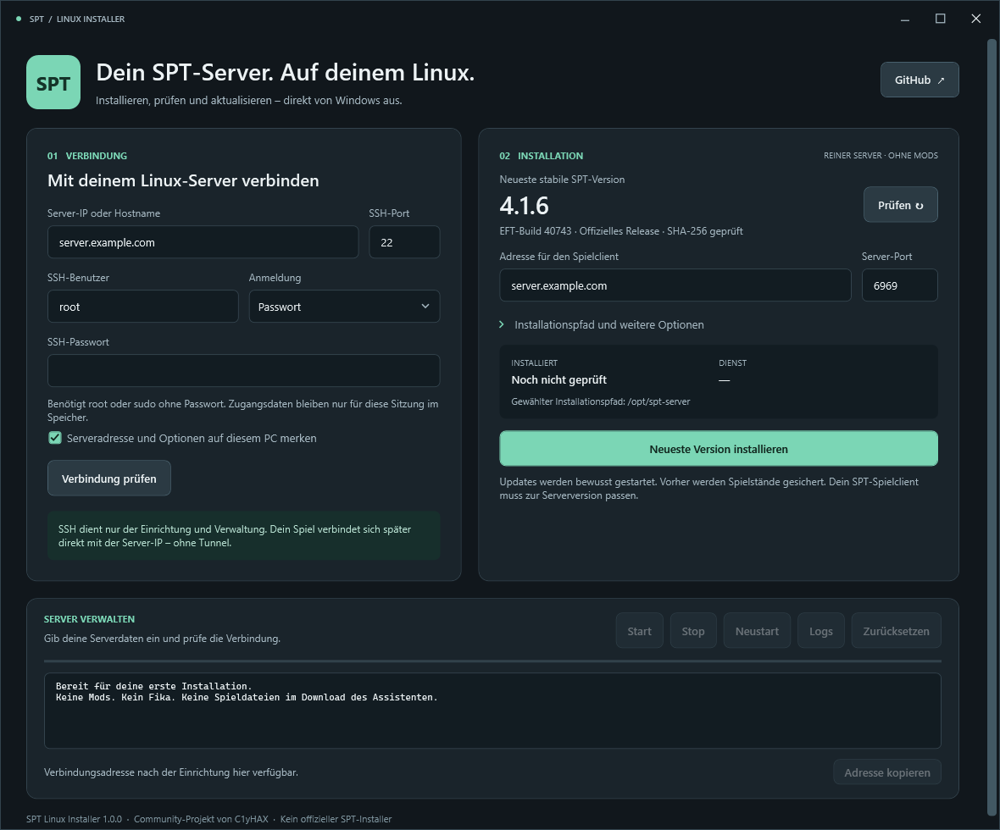

# SPT Linux Installer

A Windows desktop wizard for installing and managing a **clean SPT backend on your own Linux server**.

No Fika. No modpack. No EFT game files. No permanent SSH tunnel.

[Download for Windows](https://github.com/C1yHAX/SPT-Linux-Installer/releases/latest) ·
[Official SPT releases](https://github.com/SP-Tushonka/build/releases) ·
[Report an issue](https://github.com/C1yHAX/SPT-Linux-Installer/issues)



## Was der Assistent macht

- Rahmenlose Windows-Oberfläche mit eigener Titelleiste, dunklen Scrollleisten und passenden Dialogen.
- Passwort- oder SSH-Schlüssel-Anmeldung mit verständlichen Hinweisen zu den erlaubten SSH-Anmeldemethoden.
- Prüfung und Speicherung des SSH-Serverfingerabdrucks; geänderte Schlüssel werden abgelehnt.
- Abfrage der **neuesten stabilen SPT-Veröffentlichung** direkt bei der offiziellen Quelle.
- Download auf Linux, Prüfung des veröffentlichten SHA-256 und Installation ausschließlich des Serverteils.
- Eigene ASP.NET-Core-Laufzeit mit geprüfter SHA-512; kein Wine und kein SDK auf dem Zielserver.
- Eigener Linux-Dienst mit Autostart, Status, Start, Stop, Neustart und Loganzeige.
- Getrennte Releaseverzeichnisse, Sicherung vor Updates und Wiederherstellung des vorherigen Stands.
- Direkte Spielverbindung über die Server-IP. SSH wird nur zur Einrichtung und Verwaltung verwendet.
- Anzeige vorhandener SPT-Dienste auf dem Server mit ihrem tatsächlichen Pfad und Laufstatus.

Das Repository enthält **nur den Assistenten**, keine Kopie des SPT-Servers, keine Mods und keine Spielstände. Neue SPT-Patchversionen müssen deshalb nicht erst in dieses Repository hochgeladen werden: Der Assistent fragt die offizielle Release-API bei jedem Start und vor jeder Installation erneut ab.

## Schnellstart

1. Das ZIP aus [Releases](https://github.com/C1yHAX/SPT-Linux-Installer/releases/latest) herunterladen und entpacken.
2. `SPT-Linux-Installer.exe` starten. Auf Windows muss dafür keine zusätzliche .NET-Laufzeit installiert werden.
3. IP/Hostname, SSH-Port und Benutzer des eigenen Linux-Servers eintragen. Passwort oder privaten Schlüssel auswählen.
4. **Verbindung prüfen** und beim ersten Kontakt den angezeigten SSH-Fingerabdruck mit der Serverkonsole oder dem Anbieter vergleichen.
5. Öffentliche Spieladresse und Serverport festlegen. Standard: `/opt/spt-server`, Dienst `spt-server`, TCP-Port `6969`.
6. **Neueste Version installieren** auswählen. Der Assistent zeigt vor Änderungen Ziel und Version an.
7. Die angezeigte Adresse im normalen SPT-Launcher eintragen, beispielsweise `server.example.com:6969`, ohne `https://`.

Die Oberfläche ist zunächst auf Deutsch. Sie benötigt auf dem Windows-PC keine Administratorrechte.
Das ZIP enthält nur die EXE und eine zusammengefasste `LICENSE.txt`. Die Dokumentation bleibt im Repository.

## Voraussetzungen

| Windows-PC | Linux-Server |
|---|---|
| Windows 10/11, x64 | Ubuntu 22.04/24.04/26.04 oder Debian 12/13, x86-64 |
| Internet für die Release-Abfrage | systemd und Internetzugang zu GitHub sowie Microsoft |
| SSH-Zugang zum Zielserver | Python 3 sowie root oder `sudo` ohne Passwort für die Einrichtung |
| Passende lokale SPT-/EFT-Spielinstallation zum Spielen | Freier Installationspfad und freier TCP-Port |

ARM64 wird derzeit nicht unterstützt: Das offizielle kombinierte SPT-Archiv enthält einen Linux-x64-Server, keinen fertigen ARM64-Server.

Der Assistent richtet keine Cloud-Firewall und keine Routerfreigabe ein. Der gewählte TCP-Port muss für die vorgesehenen Spieler erreichbar sein. Eine vorhandene Installation oder ein belegter Port wird nicht automatisch übernommen. Fremde Dienste und Installationsverzeichnisse bleiben unangetastet.

## Wenn SPT bereits installiert ist

**Verbindung prüfen** prüft das gewählte Installationsziel und sucht zusätzlich nach vorhandenen SPT-Diensten unter systemd. Ein Server in einem anderen Ordner erscheint im Bereich **Vorhandene SPT-Server** mit Dienst, Pfad und Laufstatus. Die Adresse wird angezeigt, wenn sie aus der vorhandenen Serverkonfiguration ermittelt werden kann.

Diese Bestandsanzeige übernimmt einen manuell eingerichteten Server nicht automatisch. Start, Stop, Updates und Zurücksetzen beziehen sich auf das vom Assistenten verwaltete Installationsziel. Bei einem gefundenen Bestandsserver heißt der Installationsknopf deshalb **Separate Installation einrichten**. Für den vorhandenen Server ist keine Neuinstallation nötig. Ein leeres Standardziel `/opt/spt-server` bedeutet nicht, dass auf dem gesamten Linux-Server kein SPT installiert ist.

Die Erkennung ist auf direkte native SPT-4-Dienste unter systemd begrenzt und liest nur deren Dienstangaben sowie ausgewählte Servermetadaten. Container, Wine-Installationen und Dienste mit eigenen Startskripten werden nicht zuverlässig erkannt. Eine leere Fundliste ist deshalb keine vollständige Inventur des Hosts.

## Updates und Spielstände

„Neueste Version“ bedeutet **neueste stabile Veröffentlichung**, keine Entwicklungs- oder Vorabversion. Ist die Quelle nicht erreichbar oder fehlt eine belastbare Prüfsumme, wird die Installation abgebrochen; es gibt keinen stillen Rückfall auf alte Downloads.

Updates werden mit einer bewussten Aktion gestartet. Es gibt keinen Hintergrundtimer, der während eines Raids den Server ersetzt. Vor einem Update alle Spieler abmelden. Ein Update innerhalb derselben Haupt-/Nebenversion, etwa `4.1.5 → 4.1.6`, sichert den bisherigen Stand und übernimmt die persistenten Benutzerdaten. Bei einem fehlgeschlagenen Start wird der vorherige Stand wiederhergestellt.

Ein Versionswechsel wie `4.0 → 4.1` verlangt eine neue Installation. Der Assistent übernimmt dafür keine Spielstände automatisch. Der **SPT-Spielclient muss zur Serverversion passen**; der zum Release gehörende EFT-Build wird angezeigt. Siehe den [offiziellen Updateleitfaden](https://wiki.sp-tushonka.com/en/SPT_4x/Updating_SPT).

**Zurücksetzen** stellt die vorherige Serverversion **und die zugehörige Spielstandsicherung** wieder her. Neuerer Fortschritt wird vorher separat gesichert, ist danach aber nicht der aktive Stand. Eine Sicherung auf demselben Server ersetzt kein externes Backup.

Das Werkzeug ist für reine Server vorgesehen. Wer später Mods hinzufügt, muss deren Kompatibilität selbst verwalten. Sobald `user/mods` oder `user/patchers` zusätzliche Dateien enthalten, verweigert der Assistent Updates und Rollbacks. Das ist keine vollständige Integritätsprüfung aller Serverdateien: Manuelle Änderungen an Server-DLLs oder Release-Konfigurationen werden nicht übernommen.

## Verbindung und Zugangsdaten

SSH-Passwörter und Schlüssel-Passphrasen werden nicht in Einstellungen gespeichert. Optional gemerkt werden nur Serveradresse, Benutzer, Pfad zur Schlüsseldatei und Installationsoptionen. Einstellungen und bekannte Hostschlüssel liegen lokal unter `%LOCALAPPDATA%\SPT Linux Installer\`.

**Der Server entscheidet, welche Anmeldung erlaubt ist.** Wenn nur `publickey` angeboten wird, unter **Anmeldung → Privater SSH-Schlüssel** die zu diesem Konto gehörende private Schlüsseldatei auswählen. Das ist die Datei ohne `.pub`; der zugehörige öffentliche Schlüssel muss bereits auf dem Server zugelassen sein. Bei einem verschlüsselten Schlüssel zusätzlich dessen Passphrase eintragen. Ein SSH-Passwort kann eine reine Schlüsselanmeldung nicht ersetzen. Insbesondere können Cloud-Server Passwortanmeldungen für `root` sperren. Der Assistent verändert diese SSH-Regeln nicht.

Im Passwortmodus werden normale SSH-Passwortanmeldung und einfache interaktive Passwortabfragen unterstützt. Zusätzliche OTP-/MFA-Schritte und ein erforderlicher Passwortwechsel werden mit einem Hinweis abgebrochen; das eingegebene Passwort wird nicht als Einmalcode weitergereicht.

Der Spielserver verwendet HTTPS mit dem von SPT erzeugten Zertifikat. Der normale SPT-Launcher unterstützt dieses Zertifikat. Es ist kein SSH-Tunnel zum Spielen nötig.

Der SPT-Standardbenutzer der Webverwaltung und der lokale Authentifizierungs-Bypass werden deaktiviert. Die Verwaltung erfolgt über diesen Assistenten oder systemd/SSH. Diese Einstellung betrifft die Webverwaltung; SPT-Spielprofile und Spiel-API sind davon getrennt. Für private Spielgruppen kann der Betreiber den Spielport zusätzlich auf die vorgesehenen IP-Adressen begrenzen.

## Build aus dem Quellcode

Benötigt das [.NET 10 SDK](https://dotnet.microsoft.com/download/dotnet/10.0). Auf Windows `build.cmd` ausführen oder:

```powershell
dotnet test tests/SptLinuxInstaller.Tests/SptLinuxInstaller.Tests.csproj -c Release
python -m unittest discover -s tests/linux -v
dotnet publish src/SptLinuxInstaller.App/SptLinuxInstaller.App.csproj -c Release -r win-x64 --self-contained true -o artifacts/windows
./tools/Package-Portable.ps1
```

Die portable Anwendung liegt dann unter `artifacts/windows/SPT-Linux-Installer.exe`.
Das ZIP liegt unter `artifacts/SPT-Linux-Installer-Windows-x64.zip` und enthält ausschließlich die EXE und `LICENSE.txt`.
Ein Git-Tag `v*` löst den Releaseworkflow aus, der Tests, Windows-Build, ZIP und SHA-256-Datei veröffentlicht. Die SPT-Version wird nicht in diesem Build fest eingebaut.

## Aufbau

| Verzeichnis | Aufgabe |
|---|---|
| `src/SptLinuxInstaller.App` | WPF-Oberfläche und lokale Optionen |
| `src/SptLinuxInstaller.Core` | Releaseauflösung, Eingabeprüfung, Hostkey-Prüfung und SSH/SFTP |
| `installer/install.py` | Linux-Prüfungen, Download, Installation, Dienste, Updates und Wiederherstellung |
| `tests` | Tests der Release-/SSH-Eingaben und der Linux-Installationsregeln |
| `tools/SptLinuxInstaller.Smoke` | Optionaler Integrationstest gegen eine separate Testinstallation |

## English overview

This independent community tool installs a vanilla SPT Linux backend from Windows over SSH. The GUI currently uses German labels. Download the portable Windows ZIP, enter your Linux server's SSH details, verify its host key, and choose **Neueste Version installieren**. Players connect directly to the advertised server address; no game traffic uses an SSH tunnel.

The tool downloads the latest stable official release, checks its SHA-256, extracts only the Linux server, installs a private verified ASP.NET Core runtime, and creates a systemd service. Passwords are not saved. Updates are explicit, backed up and limited to compatible patch releases. Unknown existing installations are refused, and populated `user/mods` or `user/patchers` directories block updates and rollbacks. Manual changes to release files are not migrated. Linux needs Python 3 and root or passwordless sudo. You still need a matching, legitimate local EFT/SPT client to play; this tool does not provide multiplayer, Fika, game assets or mods.

## Quellen und Lizenz

Aktuelle Releases stammen aus [SP-Tushonka/build](https://github.com/SP-Tushonka/build/releases), verlinkt über die [offizielle SPT-Seite](https://sp-mod.com/installer). Das frühere `sp-tarkov/build` ist archiviert und wird nicht als Latest-Quelle verwendet. Die Laufzeit wird aus den [Microsoft-Release-Metadaten](https://builds.dotnet.microsoft.com/dotnet/release-metadata/releases-index.json) aufgelöst.

Der Installer ist MIT-lizenziert. SPT und Escape from Tarkov haben eigene Lizenzen und Rechte. Siehe [THIRD-PARTY-NOTICES.md](THIRD-PARTY-NOTICES.md). Dieses Projekt ist weder ein offizielles SPT-Produkt noch mit den Entwicklern von Escape from Tarkov verbunden.
